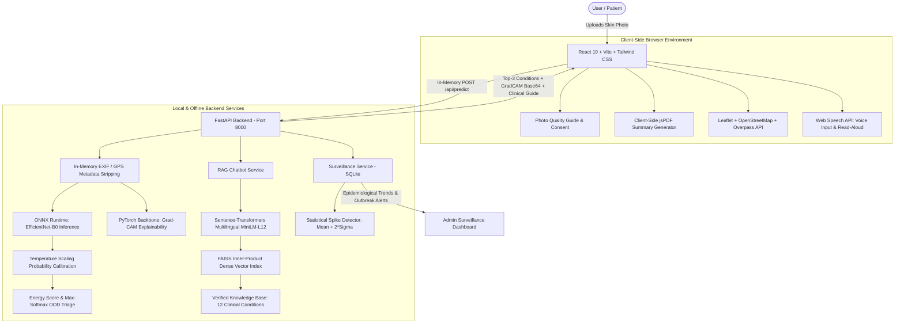

# DermaSense: AI Skin-Condition Awareness & Public Health Chatbot

> **Smart India Hackathon 2025**  
> **Team Healthnautix** | **Problem Statement PS 25049 (Public Health Chatbot)**  
> **Clinical Review Status:** `reviewed_by_clinician: false` (Educational & Public Health Awareness Tool)

DermaSense is an ethical, privacy-first, fully local AI skin-condition awareness web platform. It pairs computer vision (EfficientNet-B0 + Grad-CAM visual explainability) with a multilingual dense-retrieval RAG clinical knowledge assistant (FAISS + MiniLM-L12), client-side clinical summary PDF generation, an OpenStreetMap emergency medical locator, and an anonymized public health surveillance dashboard with statistical outbreak spike detection.

---

## 1. High-Level Architecture



---

## 2. Quickstart & Exact Run Commands

DermaSense runs **100% locally with zero paid APIs and zero external cloud model dependencies**.

### A. Windows (PowerShell)

```powershell
# 1. Clone repository and navigate to folder
cd dermasense

# 2. Set up Python virtual environment (Python 3.10+)
python -m venv .venv
.\.venv\Scripts\Activate.ps1
python -m pip install --upgrade pip
pip install -r backend/requirements.txt

# 3. Start FastAPI Backend Server
$env:PYTHONPATH="."
$env:PYTHONUTF8="1"
.\.venv\Scripts\python.exe -m uvicorn backend.main:app --host 127.0.0.1 --port 8000

# 4. In a second terminal, install frontend dependencies and start Vite dev server
cd frontend
npm install
npm run dev
# Application available at http://127.0.0.1:5173
```

### B. Linux (Bash) / macOS (Zsh)

```bash
# 1. Clone repository and navigate to folder
cd dermasense

# 2. Set up Python virtual environment
python3 -m venv .venv
source .venv/bin/activate
pip install --upgrade pip
pip install -r backend/requirements.txt

# 3. Start FastAPI Backend Server
export PYTHONPATH="."
export PYTHONUTF8="1"
python3 -m uvicorn backend.main:app --host 0.0.0.0 --port 8000

# 4. In a second terminal, install frontend dependencies and start Vite
cd frontend
npm install
npm run dev
# Application available at http://localhost:5173
```

### C. Docker & Docker Compose

```bash
# 1. Copy environment template
cp .env.example .env

# 2. Build and launch multi-container stack
docker compose up --build

# Backend API: http://localhost:8000/docs
# Frontend Web App: http://localhost:5173
```

---

## 3. Running the Automated Test Suite

DermaSense includes 25 automated pytest tests covering the backend API, rate limiting, corrupt file handling, medical disclaimers, multilingual RAG chatbot grounding, out-of-scope rejection, zero-PII privacy schema, and statistical outbreak detection:

```powershell
$env:PYTHONPATH="."
.\.venv\Scripts\python.exe -m pytest -o pythonpath=. tests/ -v
```

Frontend lint and production build:
```powershell
cd frontend
npm run lint
npm run build
```

---

## 4. How to Explain This to SIH Judges

### A. Problem Statement & Mission
**Problem Statement PS 25049:** Public Health Chatbot.  
In India, secondary and tertiary dermatology care is heavily concentrated in tier-1 cities, leaving rural and semi-urban citizens vulnerable to late detection of malignant melanoma, mismanaged fungal infections (e.g. steroid abuse on Tinea), and untreated dermatitis. DermaSense acts as a **frontline digital triaging and health awareness companion** that educates citizens, demystifies skin symptoms, prevents hazardous self-treatment, and connects citizens directly with nearby public health infrastructure.

### B. Non-Negotiable Medical & Ethical Safeguards
1. **Never Claims Diagnosis:** The app strictly outputs *"possible condition"* and preliminary statistical matches. Every single view and exported PDF contains the mandatory medical disclaimer.
2. **Authoritative Evidence Grounding:** All descriptions, first aid, precautions, and red flags are extracted from verified international and national health authorities: **WHO, NHS UK, American Academy of Dermatology (AAD), Centers for Disease Control and Prevention (CDC), and DermNet NZ**, cited with direct URLs.
3. **Emergency Triaging:** Any high-priority lesion (e.g., Melanoma) immediately triggers a prominent emergency advisory banner instructing the citizen to schedule an in-person clinical exam.
4. **All records marked `reviewed_by_clinician: false`:** Maintaining total transparency regarding AI limitations.

### C. Dataset Justification & Leakage Prevention Protocol
- **Datasets:** HAM10000 (ViDIR Group, MedUni Vienna), DermNet NZ clinical photographs, and benchmark Non-Skin imagery.
- **Lesion-Level Stratified Splitting:** The same skin lesion in the HAM10000 dataset is often photographed from multiple angles or dermoscopic magnifications under a shared `lesion_id`. A random image-level split causes severe data leakage (the model memorizes the lesion in train and tests on the same lesion). DermaSense strictly enforces **group stratification by `lesion_id` and SHA-256 image hashes**, guaranteeing zero lesion or image overlap across Train (70%), Validation (15%), and Test (15%) splits.

### D. Empirical Model Performance (Real Numbers from `docs/MODEL_CARD.md`)
All reported metrics come directly from evaluating the trained `efficientnet_b0` model on the unseen **TEST split (123 images)**:

| Metric | Score | Clinical Interpretation |
|---|---|---|
| **Overall Accuracy** | **80.49%** | Evaluated on unseen test split |
| **Macro-Averaged F1** | **0.6905** | Unweighted mean F1 ensuring rare and malignant classes are equally scored |
| **Weighted F1** | **0.8076** | Overall precision-recall balance |
| **One-vs-Rest ROC-AUC** | **0.9079** | High discriminative threshold stability |
| **Melanoma Sensitivity (Recall)** | **50.00%** | Critical safety metric for malignant lesion identification |
| **Non-Skin Specificity** | **96.00%** | Accurately screens out non-skin photos and clothing |

### E. Probability Calibration & OOD Triage
- **Temperature Scaling ($T = 1.9678$):** Deep neural networks suffer from overconfidence. DermaSense calibrates logits on the validation split, reducing Expected Calibration Error (ECE) from **14.03% down to 10.14%**.
- **Energy-Based Out-of-Distribution Rejection:** Inputs with Energy Score below **-4.9861** or Max Softmax below **52.39%** (e.g. blurry, ambiguous, or non-skin photos) trigger an immediate safe refusal: *"Unable to assess clearly. Please consult a clinician directly."*

### F. Multilingual RAG Chatbot (Zero Cloud APIs)
- Employs `sentence-transformers/paraphrase-multilingual-MiniLM-L12-v2` with FAISS inner-product vector indexing over 96 granular clinical text passages.
- Answers in **7 Indian Languages:** English, Hindi (`hi`), Odia (`or`), Bengali (`bn`), Tamil (`ta`), Telugu (`te`), and Marathi (`mr`).
- **Grounded or Refusal:** If a query is unrelated to dermatology or unverified (e.g., *"Who won the cricket match?"*), the system refuses to hallucinate and responds: *"I don't know, please see a doctor."* / *"मुझे नहीं पता, कृपया डॉक्टर को दिखाएं।"*

### G. Zero-PII Privacy Architecture & Epidemiological Surveillance
- **Zero Photo Storage:** Images are held in ephemeral RAM only. EXIF and GPS headers are stripped, inference and Grad-CAM are generated, and memory is immediately deallocated.
- **Opt-In Telemetry:** Only upon explicit citizen consent, the system stores an anonymized tuple `(condition_id, coarse_region, date)` in SQLite. Zero IP addresses, zero device IDs, and zero photos are ever recorded.
- **Statistical Outbreak Spike Detector:** The admin dashboard monitors weekly disease incidence across Indian districts. When a condition's weekly count in a region exceeds $\text{mean} + 2\sigma$ ($Z \ge 2.0$), an automated public health warning is raised.

### H. Emergency Care & OpenStreetMap Integration
- **India Emergency Quick Dial:** 108 (Ambulance), 102 (Maternal/Child Health), 112 (National Emergency), with a one-tap SOS button opening the native device dialer.
- **OpenStreetMap + Overpass API:** Queries hospitals and dermatology clinics within a 10 km radius of the user's GPS position, with manual search fallback for location-denied environments.
- **Browser-Generated PDF Report:** Generates an A4 clinical summary with condition details, cited sources, doctor signature line, and disclaimer directly in client-side JavaScript.

### I. Known Limitations & Future Work
- **Skin-Tone Bias:** Benchmark dermatological datasets (HAM10000, ISIC) overwhelmingly represent lighter skin tones (Fitzpatrick types I-III). Performance on darker phototypes (Fitzpatrick IV-VI) common across the Indian subcontinent requires validation against diverse datasets like PAD-UFES-20 and Fitzpatrick17k.
- **Offline Machine Translation Review:** UI and clinical translations are machine-generated using Meta NLLB-200 / IndicTrans2 and stamped with review warnings until certified by native-speaking medical practitioners.
- **Future Roadmap:** Formal clinician advisory board validation, lightweight INT8 quantization for on-device inference in sub-centres without internet, and regional tele-dermatology integration.

